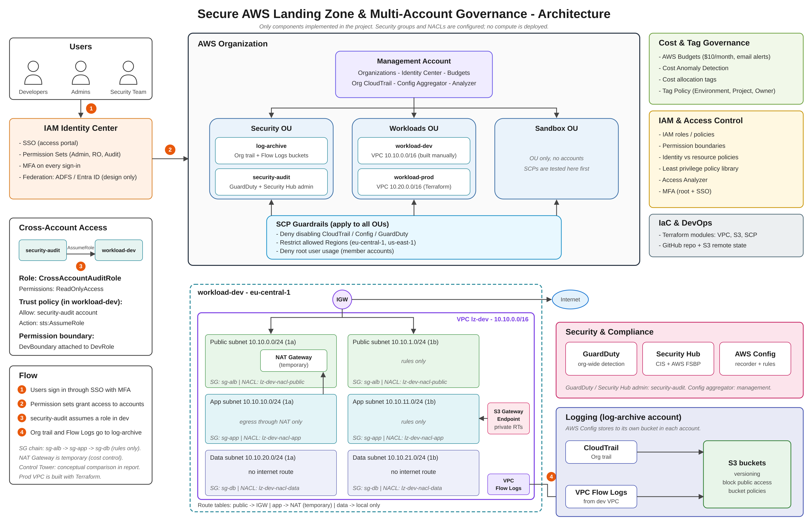

# Secure AWS Landing Zone & Multi-Account Governance

A secure, multi-account AWS foundation: account isolation with AWS Organizations, centralized identity with least privilege, a segmented network baseline, organization-wide logging and threat detection, preventive guardrails with SCPs, and part of the baseline written as Infrastructure as Code.



## Problem

Many teams start on AWS with a single account holding everything. That means a large blast radius, broad and unreviewed permissions, little visibility into who did what, no guardrails against dangerous changes, and weak cost control.

## Solution

| Area | What is built |
|---|---|
| Account structure | AWS Organizations with Security and Workloads OUs, plus a Sandbox OU. Accounts: management, log-archive, security-audit, workload-dev, workload-prod |
| Identity | IAM Identity Center with groups and permission sets, MFA, cross-account roles, permission boundary, Access Analyzer |
| Network | VPC with public / app / data tiers across two AZs, route tables, IGW, temporary NAT, security groups, NACLs, S3 gateway endpoint, VPC Flow Logs |
| Logging and detection | Organization CloudTrail, AWS Config, GuardDuty, Security Hub |
| Governance | SCP guardrails, tag policy, cost allocation tags, AWS Budgets, Cost Anomaly Detection |
| Automation | Terraform modules for VPC, log bucket and SCPs |

## Weekly scope

| Week | Focus | Main deliverables |
|---|---|---|
| 1 | Foundations, accounts, Organizations | Account/OU diagram, root security checklist, Budgets, shared responsibility summary |
| 2 | IAM, federation, account security | IAM baseline, policy library, permission boundary, cross-account lab, federation design, access review |
| 3 | Secure network foundation | VPC diagram, subnet/IP plan, SG/NACL matrix, endpoint design, Flow Logs, network checklist |
| 4 | Governance, logging, compliance, automation | Terraform templates, SCP set, org trail and Config, Security Hub baseline, compliance dashboard, final report |

## Repository structure

```
.
├── docs/         Diagrams, design documents, final report
├── evidence/     Screenshots and command output per week
├── policies/     IAM policy library (JSON)
├── terraform/    Modules and environments (IaC)
└── README.md
```

## Design decisions

- **Multi-account**: limits blast radius and separates billing and permissions.
- **Dedicated log-archive account**: a compromised workload account cannot tamper with audit logs.
- **Identity Center instead of long-lived IAM users**: temporary credentials, central management, MFA enforced at sign-in.
- **SCPs tested on a non-critical OU first**: a wrong SCP can lock accounts out.
- **Data tier without an internet route**: layered segmentation (public / app / data).

## Security and cost notes

- No credentials, access keys or Terraform state are committed (see `.gitignore`).
- Account IDs are masked in published screenshots.
- NAT Gateways, Elastic IPs and Interface endpoints are billed hourly, so they are created for evidence and removed in the same session.

## Status

- [ ] Week 1: Organization, OUs, accounts, root security, Budgets
- [ ] Week 2: Identity Center, cross-account lab, permission boundary, policy library
- [ ] Week 3: VPC, subnets, SG/NACL, endpoint, Flow Logs
- [ ] Week 4: Org trail, Config, GuardDuty, Security Hub, SCPs, Terraform, final report

## Author

Mostafa Mohamed Abdrabo, Cloud Security Engineering. Built as a graduation project for the DEPI.
