# 🛡️ Secure AWS Landing Zone & Governance


Secure AWS Landing Zone & Governance is a hands-on cloud security project that builds a secure baseline on AWS: hardened account access with MFA, least-privilege IAM, a segmented VPC (public / app / data tiers) with layered security groups and NACLs, and centralized logging, configuration tracking and threat detection with CloudTrail, AWS Config, GuardDuty and Security Hub, plus cost guardrails with AWS Budgets and Infrastructure as Code with Terraform.

---

## 📑 Table of Contents
- [Overview](#-overview)
- [Scope & Constraints](#-scope--constraints)
- [Features](#-features)
- [Architecture](#-architecture)
- [AWS Services Used](#-aws-services-used)
- [Design Decisions](#-design-decisions)
- [Project Structure](#-project-structure)
- [Screenshots](#-screenshots)
- [Security & Cost Notes](#-security--cost-notes)
- [Team](#-Team)

---

## 🎯 Overview

Many teams start on AWS with everything in one account: a wide blast radius, broad and unreviewed permissions, little visibility into who did what, no guardrails against dangerous changes, and weak cost control.

This project addresses that with a secure baseline built in four stages:

| Week | Focus | Main outcome |
| :--- | :--- | :--- |
| 1 | Foundations & account security | Organization setup, root/MFA hardening, budgets and cost guardrails |
| 2 | IAM & access security | Least-privilege policies, permission boundary, access analysis |
| 3 | Secure network foundation | VPC with tiered subnets, SGs, NACLs, endpoint, Flow Logs |
| 4 | Governance, logging & detection | CloudTrail, Config, GuardDuty, Security Hub |

---

## 🧭 Scope & Constraints

The project was implemented in a **single AWS account**, working through IAM users. Because of that:

- Everything that runs inside one account was **implemented and evidenced** with screenshots (see [Screenshots](#-screenshots)).
- Parts that need several accounts (member accounts and OUs, IAM Identity Center, enforced SCPs, cross-account roles, an organization-wide trail) are **covered as design and documentation** rather than deployed.

This is called out explicitly so the reader knows what is built versus designed.

---

## 🚀 Features

- ✅ **Account Hardening:** MFA enabled, root access reviewed, and billing alerts configured.
- ✅ **Cost Guardrails:** AWS Budgets with email alerts to catch unexpected spend early.
- ✅ **Least-Privilege IAM:** Policies scoped to specific actions and resources, with a permission boundary as a hard ceiling.
- ✅ **Layered Network Security:** Public, app and data subnets; security groups chained by reference (ALB → App → DB); stateless NACLs per tier; data tier with no internet route.
- ✅ **Controlled Egress:** Internet Gateway for public subnets, NAT Gateway only for the private app tier (temporary, for cost).
- ✅ **Network Visibility:** VPC Flow Logs enabled for the VPC.
- ✅ **Audit Logging:** CloudTrail records account activity.
- ✅ **Configuration Tracking:** AWS Config records resource configuration and evaluates rules.
- ✅ **Threat Detection & Posture:** GuardDuty findings and Security Hub standards and coverage.

---

## 📐 Architecture


**Flow:**
1. Users sign in with **IAM users protected by MFA**.
2. **IAM policies** grant only the permissions each role needs, and a **permission boundary** caps what delegated roles can ever do.
3. Workloads live in a **VPC** with three tiers: public, app and data subnets across two Availability Zones.
4. The **Internet Gateway** serves the public tier. The app tier reaches the internet only through a **NAT Gateway**. The data tier has **no route to the internet**.
5. **Security groups** (ALB → App → DB) and **NACLs** filter traffic at the instance and subnet level.
6. **VPC Flow Logs** capture network traffic metadata.
7. **CloudTrail** records API activity, **AWS Config** tracks configuration changes, and **GuardDuty** and **Security Hub** surface threats and misconfigurations.
8. **AWS Budgets** alerts by email when spend approaches the limit.

---

## 🛠 AWS Services Used

| Service | Role | Week |
| :--- | :--- | :---: |
| **AWS Organizations** | Organization setup and consolidated billing | 1 |
| **AWS Budgets** | Monthly cost budget with email alerts | 1 |
| **AWS IAM** | Users, roles, least-privilege policies, permission boundary | 2 |
| **IAM Access Analyzer** | Finds resources shared outside the account | 2 |
| **Amazon VPC** | Subnets, route tables, Internet Gateway, NAT Gateway | 3 |
| **Security Groups & NACLs** | Layered traffic filtering per tier | 3 |
| **VPC Flow Logs** | Network traffic visibility | 3 |
| **AWS CloudTrail** | Audit log of API activity | 4 |
| **AWS Config** | Resource configuration tracking and rules | 4 |
| **Amazon GuardDuty** | Threat detection | 4 |
| **AWS Security Hub** | Security standards, findings and coverage | 4 |
| **Amazon S3** | Log storage with versioning and blocked public access | 3-4 |
| **Terraform** | Infrastructure as Code for the VPC, log bucket and guardrail policies | 4 |
| **Git & GitHub** | Version control and project documentation | 1-4 |

---

## 🧠 Design Decisions

- **Tiered subnets (public / app / data):** limits how far an attacker can move if one tier is compromised.
- **Security groups reference other security groups, not IP ranges:** rules stay correct when instances change.
- **NACLs as a second, stateless layer:** they require explicit return-traffic rules (ephemeral ports), which is documented in the SG/NACL matrix.
- **Data tier without an internet route:** databases never need direct internet access.
- **NAT Gateway kept temporary:** it is billed hourly, so it is created for evidence and removed.
- **Least privilege first:** policies name specific actions and resources, and a permission boundary limits delegated roles.

---

## 📁 Project Structure

```text
aws-secure-landing-zone/
├── docs/                  # Architecture diagram and design documents
│   ├── architecture.png
│   └── architecture.svg
├── evidence/              # Screenshots per week
│   ├── week1/
│   ├── week2/
│   ├── week3/
│   └── week4/
├── policies/              # IAM policy library (JSON)
├── terraform/             # IaC modules and environments (optional / in progress)
├── .gitignore
└── README.md
```

---

## 📸 Screenshots

### Week 1: Foundations & Account Security


*AWS Organizations console.*


*Email verification for the organization.*

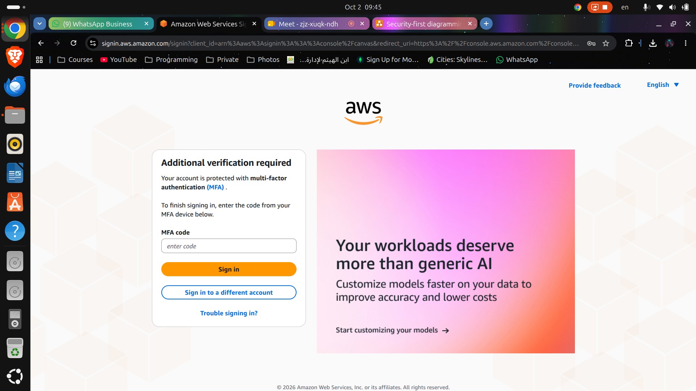
*MFA enabled on the account.*

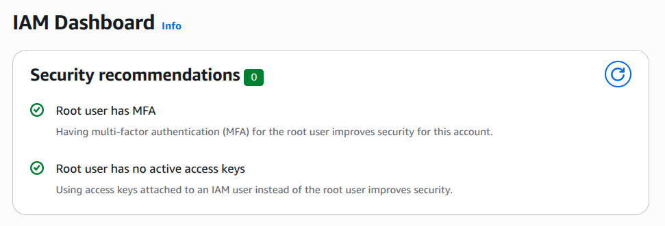
*Security credentials review for the root user.*

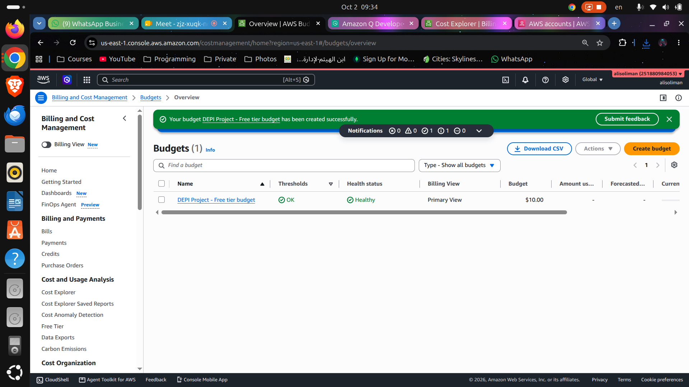
*AWS Budgets with a monthly cost limit and email alerts.*

### Week 2: IAM & Access Security

<!-- Add your Week 2 screenshots here, for example:

*Short caption.*
-->
*Add IAM users/roles, permission boundary and Access Analyzer evidence here.*

### Week 3: Secure Network Foundation


*VPC created with the planned CIDR.*


*Public, app and data subnets across two Availability Zones.*


*Internet Gateway attached to the VPC.*


*NAT Gateway for private egress (temporary).*


*Route tables per tier.*


*Network ACLs per tier with explicit inbound and outbound rules.*

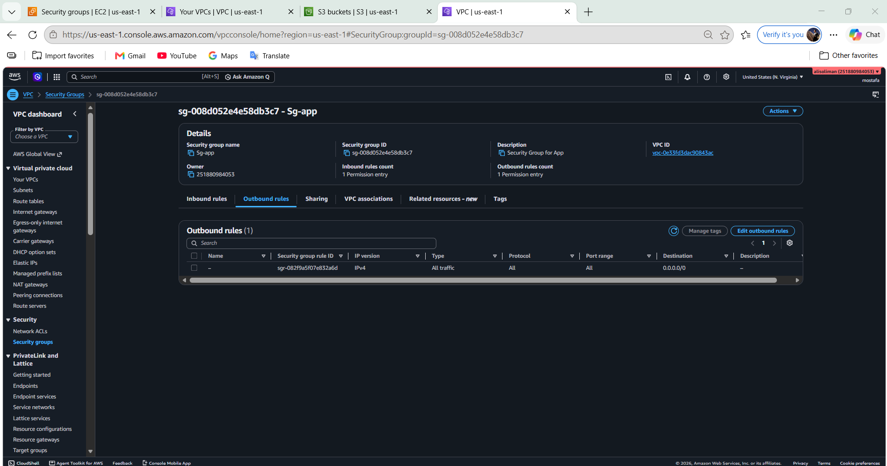
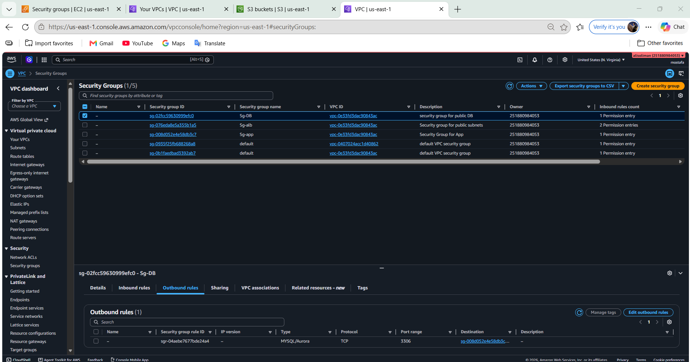
*Security group rules for the app and database tiers.*


*VPC Flow Logs enabled.*

### Week 4: Governance, Logging & Detection

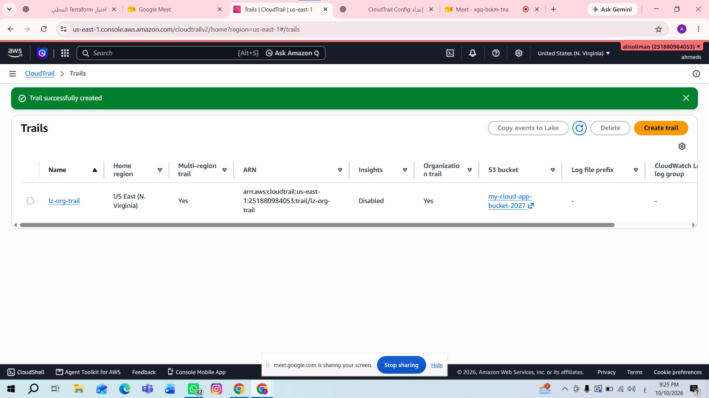
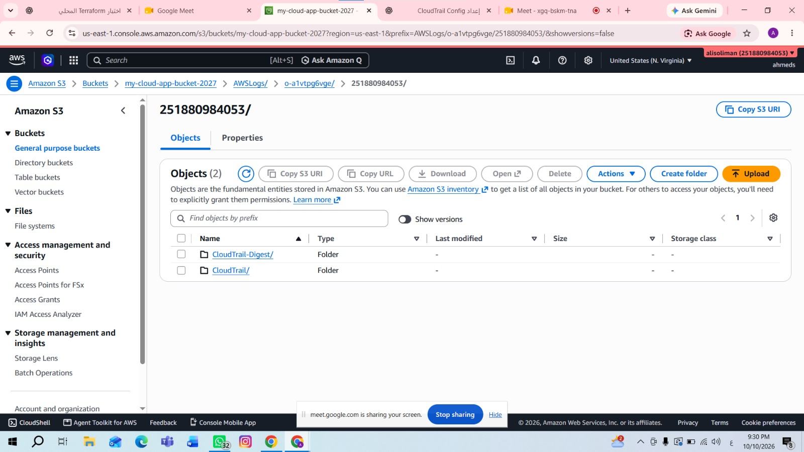
*CloudTrail trail and recorded activity.*

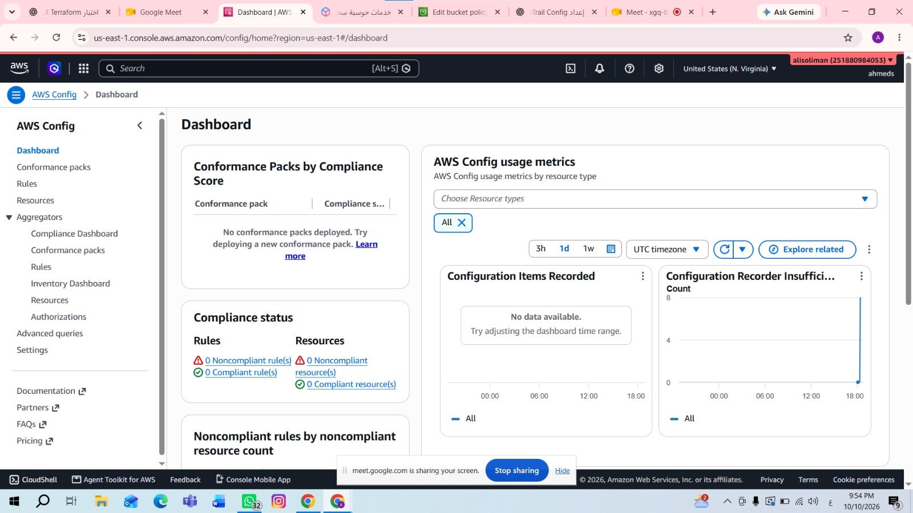
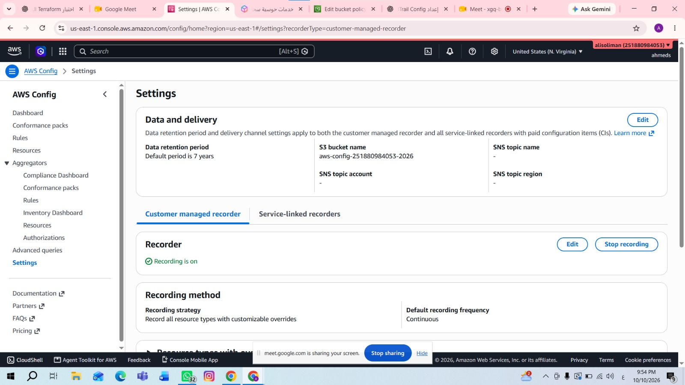
*AWS Config recorder and rule compliance.*

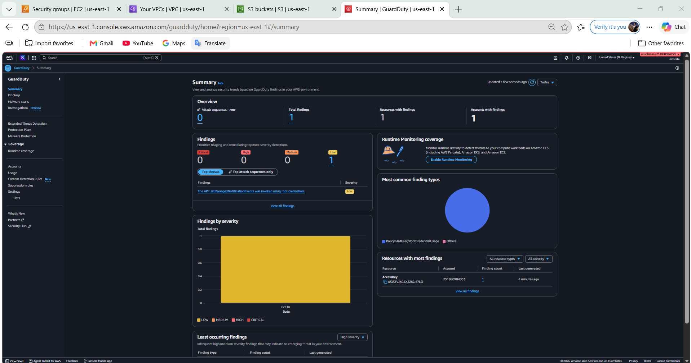
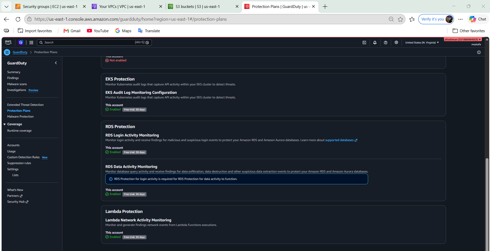
*GuardDuty summary and enabled protection plans.*

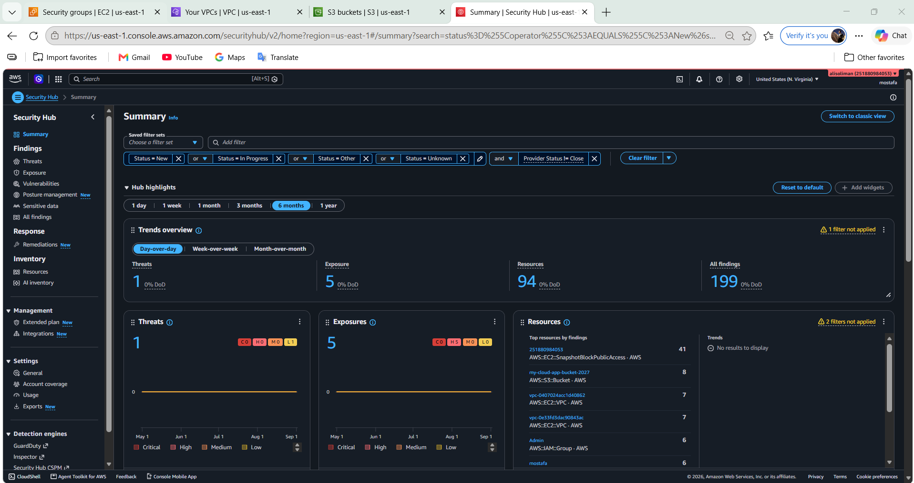
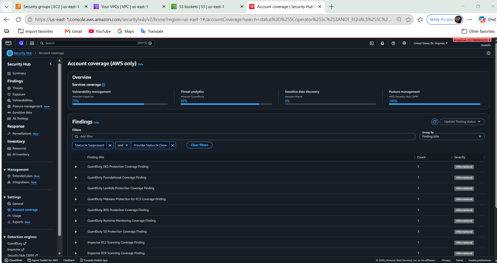
*Security Hub standards, findings and coverage.*

---

## 🔒 Security & Cost Notes

- No credentials, access keys or Terraform state are committed (see `.gitignore`).
- Account identifiers are masked in published screenshots.
- NAT Gateways, Elastic IPs and interface endpoints are billed hourly, so they are created for evidence and removed in the same session.
- Budgets and anomaly alerts are configured to catch unexpected spend early.

---

## 👤 Team

- **Mostafa Mohamed Abdrabo**
- **Ali Wael Ali Soliman**
- **Aya Eid Ahmed Mousa**
- **Ahmed Sayed Hatem Mohamed**
- **Lamees Mamdouh Ibrahim Abdelhamed**
- **Ahmed Zakaria Ismail Elmahdy**

[](https://www.linkedin.com/in/mostafa-m-abdrabo/)
[](https://github.com/mostafaabdrabo2022)
[](mailto:mostafaabdrabo4900@gmail.com)

---